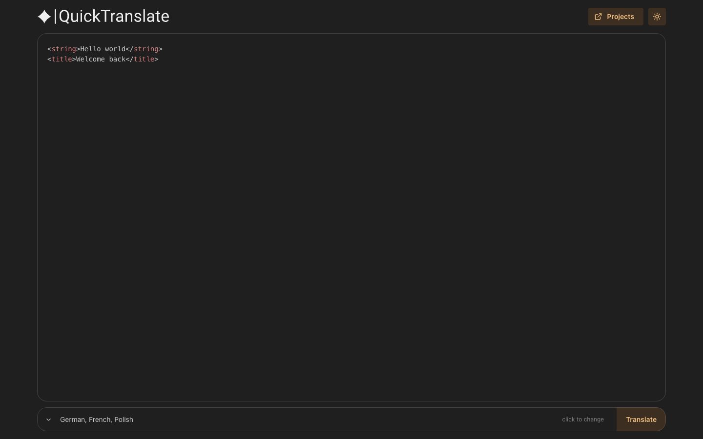
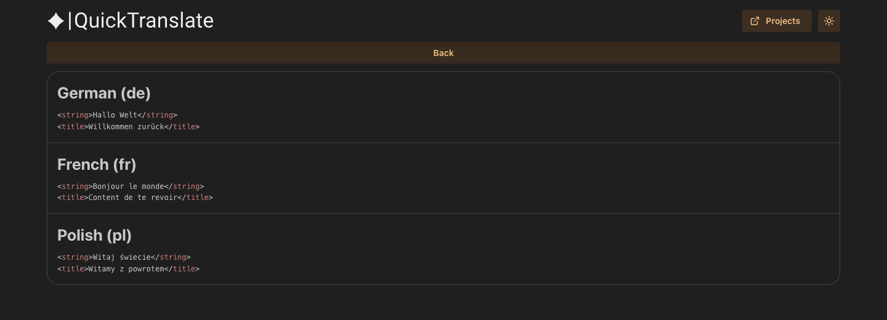

# QuickTranslate

Web app for translating XML-tagged strings into a few languages at once. Tags stay put; only the text inside them gets translated.

Example input:

```xml
<string>Hello world</string>
<title>Welcome back</title>
```

Pick languages, hit Translate, get the same markup back per language.





## What it does

- Batch translate to: Catalan, Czech, German, Estonian, French, Hungarian, Croatian, Italian, Polish, Russian, Slovak, Swedish
- Keeps XML-ish tags, translates inner text only
- Editor with syntax highlighting, copyable results, light/dark theme
- Backend is Amplify Gen 2 (Lambda + API Gateway)

## Stack

- **Frontend:** React 18, CRA, Mantine 7, Prism, Amplify JS v6 (install/build with Bun)
- **Backend:** Amplify Gen 2, Lambda, API Gateway, `google-translate-api-x` (npm + Node ≥ 22)

Translation has to run on the server. Browser Google Translate calls hit CORS / scraping limits, and we need to parse tags, translate the insides, and rebuild the markup without putting that logic (or rate limits) in the client.

## Setup

Needs:

- [Bun](https://bun.sh) ≥ 1.4 for the frontend
- Node ≥ 22 + npm ≥ 10 for Gen 2 / `ampx`
- AWS credentials (`amplify` profile or default)

Frontend = Bun (`bun.lock`). Backend / Hosting backend phase = npm (`package-lock.json`). Don't run sandbox or `pipeline-deploy` with Bun.

```bash
git clone https://github.com/AkiraGold/QuickTranslate.git
cd QuickTranslate

bun install
npm install          # if you need the backend locally

npm run sandbox      # or: npm run sandbox:once
# writes src/amplify_outputs.json

bun start            # http://localhost:3000
```

## Scripts

```bash
bun start
bun run build
bun test

npm run sandbox
npm run sandbox:once
npm run backend:deploy   # production backend (Amplify app / master)
```

## Layout

```text
amplify/                    Gen 2 backend (translate function + API)
docs/                       screenshots for this README
public/
scripts/ampx.js             ampx wrapper, outputs go to src/
src/
  Elements/
  PageParts/
  constants/
  amplify_outputs.json      generated, don't edit by hand
amplify.yml                 Amplify Hosting build
package.json
```

## Deploy

`amplify.yml` runs backend then frontend:

1. `npm ci`, then `ampx pipeline-deploy` (writes `src/amplify_outputs.json`)
2. Bun install, then `bun run build` (output in `build/`)

Or push the backend yourself:

```bash
CI=1 npm run backend:deploy
```

## License

All rights reserved.
